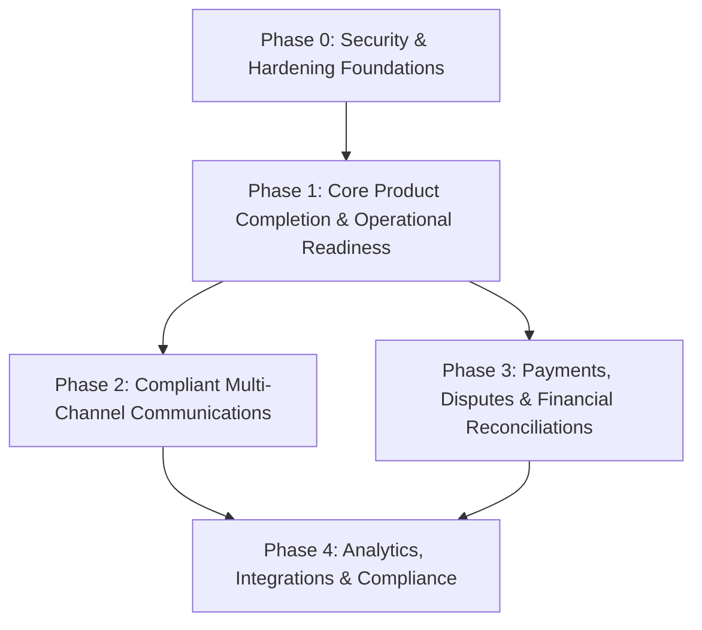

# ACCO — Master Roadmap

> **Milestone**: Production Readiness & Security Architecture (Phases 0–4)  
> **Status**: `PLANNING COMPLETE`  
> **Target Version**: `0.2.0`  
> **Updated**: 2026-10-13  

---

## 1. Roadmap Overview & Dependency Graph

---

## 2. Phase 0: Security & Production Hardening Foundations

**Objective:** Transform ACCO from a prototype modular monolith into a hardened, enterprise-grade, multi-tenant system with robust authentication, role-based access control, cryptographic data protection, and immutable audit logs.

### Task 0.1: Configuration Hardening & Production Fail-Closed Secrets
- **Objective:** Enforce fail-closed secret validation in Pydantic Settings when running in production mode.
- **Files to Inspect First:** `backend/app/core/config.py`, `backend/app/main.py`.
- **Expected Changes:**
  - Add validator in `Settings` requiring `ACCO_JWT_SECRET_KEY` and `ACCO_ENCRYPTION_KEY` to be at least 32 random characters in non-development environments.
  - Reject default placeholders (`"replace_this_with_a_long_random_string"`, `"secret"`) when `ACCO_ENVIRONMENT == "production"`.
  - Introduce `ACCO_CORS_ALLOWED_ORIGINS` with strict domain parsing.
- **Migration & Rollback:** No database changes. Reversible by configuration.
- **Tests to Add:** `tests/test_config.py` verifying production startup rejects weak/default keys and accepts valid configurations.
- **Acceptance Criteria:** Application raises `ValidationError` on startup if mandatory secrets are absent or weak in production mode.
- **Verification Command:** `.\venv\Scripts\pytest.exe -v tests/test_config.py`
- **Dependencies:** None.

### Task 0.2: RBAC Schema Expansion & ADMIN Role Migration
- **Objective:** Add `ADMIN` role to `UserRole` enum in model, Alembic migration, and endpoint authorization dependencies.
- **Files to Inspect First:** `backend/app/models/user.py`, `backend/app/api/deps.py`, `backend/migrations/versions/`.
- **Expected Changes:**
  - Update `UserRole` enum in `backend/app/models/user.py`: add `ADMIN = "ADMIN"`.
  - Create Alembic migration `20261013_09_add_admin_role.py` with PostgreSQL `ALTER TYPE userrole ADD VALUE 'ADMIN';`.
  - Update `require_roles` calls across API endpoints to grant administrative access to `[UserRole.OWNER, UserRole.ADMIN]`.
- **Migration & Rollback:** Alembic migration with checked downgrade.
- **Tests to Add:** `tests/test_roles.py` verifying `ADMIN` user creation, role assignment, and endpoint authorization.
- **Acceptance Criteria:** `ADMIN` role is fully supported by ORM and database; role checks permit `ADMIN` on management endpoints.
- **Verification Command:** `.\venv\Scripts\pytest.exe -v tests/test_roles.py`
- **Dependencies:** Task 0.1.

### Task 0.3: Refresh Token Rotation & Session Revocation
- **Objective:** Implement single-use refresh token rotation, hashed token persistence, and token family replay detection.
- **Files to Inspect First:** `backend/app/core/security.py`, `backend/app/api/v1/endpoints/auth.py`, `backend/app/models/`.
- **Expected Changes:**
  - Create `RefreshToken` model in `backend/app/models/refresh_token.py` (fields: `id`, `user_id`, `token_hash`, `family_id`, `is_revoked`, `expires_at`).
  - Create Alembic migration for `refresh_tokens` table.
  - Implement `/api/v1/auth/refresh` endpoint: rotates tokens on each use; if an already-revoked token is presented, revokes all tokens in `family_id`.
  - Implement `/api/v1/auth/logout` endpoint: marks active refresh token family revoked.
- **Migration & Rollback:** Alembic migration creating `refresh_tokens` table; downgrade drops table.
- **Tests to Add:** `tests/test_auth_tokens.py` verifying normal rotation, family invalidation on token reuse, and logout revocation.
- **Acceptance Criteria:** Refresh tokens cannot be replayed; token reuse revokes the whole family; access token expires in 15 minutes.
- **Verification Command:** `.\venv\Scripts\pytest.exe -v tests/test_auth_tokens.py`
- **Dependencies:** Task 0.2.

### Task 0.4: Account Recovery & Password Reset Flow
- **Objective:** Implement secure time-limited, hashed password reset tokens with constant-time response and session invalidation.
- **Files to Inspect First:** `backend/app/api/v1/endpoints/auth.py`, `backend/app/core/security.py`, `backend/app/models/user.py`.
- **Expected Changes:**
  - Create `PasswordResetToken` model (or token table) storing SHA-256 hashed reset token, expiry (60 minutes), and consumed status.
  - Create Alembic migration.
  - Implement `POST /api/v1/auth/forgot-password`: constant-time response regardless of user existence.
  - Implement `POST /api/v1/auth/reset-password`: validates token, updates password hash, and invalidates all active refresh tokens for the user.
- **Migration & Rollback:** Alembic migration; downgrade drops table.
- **Tests to Add:** `tests/test_password_reset.py` verifying reset link generation, expiry after 60 min, successful reset, and session invalidation.
- **Acceptance Criteria:** Password reset invalidates prior sessions; token cannot be used twice; timing safe.
- **Verification Command:** `.\venv\Scripts\pytest.exe -v tests/test_password_reset.py`
- **Dependencies:** Task 0.3.

### Task 0.5: TOTP Multi-Factor Authentication (MFA)
- **Objective:** Implement RFC 6238 TOTP setup, verification, recovery backup codes, and role-based enforcement for OWNER and ADMIN.
- **Files to Inspect First:** `backend/app/models/user.py`, `backend/app/api/v1/endpoints/auth.py`, `backend/app/core/security.py`.
- **Expected Changes:**
  - Add columns to `users`: `totp_secret_encrypted`, `is_mfa_enabled`, `backup_codes_hashed`.
  - Create Alembic migration.
  - Implement `POST /api/v1/auth/mfa/setup` (returns secret and backup codes), `POST /api/v1/auth/mfa/enable` (validates code), `POST /api/v1/auth/mfa/verify` (accepts code or backup code).
  - Update `POST /api/v1/auth/login`: if user has MFA enabled or role in `[OWNER, ADMIN]`, return `202 Accepted` with ephemeral `mfa_ticket`.
- **Migration & Rollback:** Alembic migration adding MFA columns to `users`.
- **Tests to Add:** `tests/test_mfa.py` verifying TOTP generation, validation, invalid code rejection, backup code redemption, and role enforcement.
- **Acceptance Criteria:** OWNER and ADMIN cannot access protected endpoints without completing MFA verification.
- **Verification Command:** `.\venv\Scripts\pytest.exe -v tests/test_mfa.py`
- **Dependencies:** Tasks 0.2, 0.3.

### Task 0.6: Tenant Isolation & PostgreSQL Row Level Security (RLS)
- **Objective:** Implement defense-in-depth tenant isolation via PostgreSQL RLS policies alongside strict repository filtering.
- **Files to Inspect First:** `backend/app/db/session.py`, `backend/app/api/deps.py`, `backend/migrations/versions/`.
- **Expected Changes:**
  - Connection checkout hook sets session variable: `SET LOCAL app.current_tenant_id = :org_id;` when executing in PostgreSQL.
  - Create Alembic migration enabling RLS on all tenant-owned tables (`organizations`, `users`, `customers`, `invoices`, `payments`, `payment_allocations`, `collection_policies`, `customer_reply_analyses`, `email_deliveries`).
  - Add RLS policy: `CREATE POLICY tenant_isolation_policy ON <table> USING (organization_id = NULLIF(current_setting('app.current_tenant_id', true), '')::uuid);`.
  - Maintain graceful compatibility with SQLite in testing environments.
- **Migration & Rollback:** Alembic migration with RLS enable/disable commands.
- **Tests to Add:** `tests/test_tenant_isolation.py` asserting cross-tenant queries return empty results even if application filter is absent.
- **Acceptance Criteria:** Cross-tenant access is structurally prevented at both repository layer and database engine level.
- **Verification Command:** `.\venv\Scripts\pytest.exe -v tests/test_tenant_isolation.py`
- **Dependencies:** Task 0.2.

### Task 0.7: HTTP Hardening, Security Headers & Rate Limiting
- **Objective:** Configure OWASP-compliant security headers, CORS origin restrictions, payload size limits, and per-endpoint rate limiting.
- **Files to Inspect First:** `backend/app/main.py`, `backend/app/core/config.py`.
- **Expected Changes:**
  - Add security headers middleware (`HSTS`, `X-Content-Type-Options`, `X-Frame-Options`, `Content-Security-Policy`, `Referrer-Policy`).
  - Replace wildcard CORS with strict origin list.
  - Implement rate limiting middleware (e.g. `slowapi` or Redis-backed rate limiter) on `/auth/login`, `/auth/mfa/verify`, and webhook endpoints.
  - Add request body size limiter middleware (max 5 MB for JSON, 25 MB for CSV imports).
- **Migration & Rollback:** No database changes.
- **Tests to Add:** `tests/test_security_headers.py` checking response headers, 429 Too Many Requests on rate limit breach, and 413 Payload Too Large.
- **Acceptance Criteria:** Security headers present on every response; brute force on auth endpoints triggers 429.
- **Verification Command:** `.\venv\Scripts\pytest.exe -v tests/test_security_headers.py`
- **Dependencies:** Task 0.1.

### Task 0.8: Field-Level Sensitive Data Encryption & Key Rotation
- **Objective:** Build an authenticated AES-256-GCM / Fernet field encryption utility supporting key version prefixes and zero-downtime key rotation.
- **Files to Inspect First:** `backend/app/core/security.py`, `backend/app/core/config.py`.
- **Expected Changes:**
  - Create `FieldEncryptor` utility supporting primary key for encryption and fallback keys for decryption.
  - Apply to TOTP secrets, webhook signing secrets, and third-party API credentials.
  - Output format: `v1:{key_id}:{iv}:{ciphertext}:{auth_tag}`.
- **Migration & Rollback:** Non-destructive utility; existing columns updated via migration.
- **Tests to Add:** `tests/test_encryption.py` verifying round-trip encryption, decryption with retired fallback key, and tampering detection.
- **Acceptance Criteria:** Sensitive credentials are encrypted at rest; key rotation decrypts old data and re-encrypts with new key.
- **Verification Command:** `.\venv\Scripts\pytest.exe -v tests/test_encryption.py`
- **Dependencies:** Task 0.1.

### Task 0.9: PII-Safe Structured Logging & Redaction
- **Objective:** Implement logging filters that sanitize sensitive PII (emails, phone numbers, tokens, banking details) across all log outputs.
- **Files to Inspect First:** `backend/app/core/logging.py`, `backend/app/main.py`.
- **Expected Changes:**
  - Create `PIIMaskingFilter` that intercepts all log records.
  - Redact email addresses (`j***@example.com`), phone numbers (`***-***-1234`), tokens, and bank details.
  - Configure root and application loggers to enforce the filter in all environments.
- **Migration & Rollback:** Purely in application logging layer.
- **Tests to Add:** `tests/test_logging.py` asserting log statements containing customer emails, card numbers, or auth tokens are redacted.
- **Acceptance Criteria:** Zero plaintext PII or secrets appear in captured log outputs.
- **Verification Command:** `.\venv\Scripts\pytest.exe -v tests/test_logging.py`
- **Dependencies:** Task 0.1.

### Task 0.10: Append-Only Audit Event Logging Engine
- **Objective:** Implement immutable `AuditEvent` model, service, and administrative query endpoint for all financial and security mutations.
- **Files to Inspect First:** `backend/app/models/`, `backend/app/services/`, `backend/app/api/v1/endpoints/`.
- **Expected Changes:**
  - Create `AuditEvent` model (`id`, `organization_id`, `actor_id`, `actor_type`, `action`, `entity_type`, `entity_id`, `timestamp`, `ip_address`, `payload_diff`).
  - Create Alembic migration.
  - Create `audit_service.py` with `record_audit_event()`.
  - Expose `GET /api/v1/audit-events` (restricted to `OWNER` and `ADMIN`).
- **Migration & Rollback:** Alembic migration creating `audit_events` table; downgrade drops table.
- **Tests to Add:** `tests/test_audit.py` verifying event recording on entity creation/mutation and read-only query endpoint filtering.
- **Acceptance Criteria:** Every sensitive mutation creates an immutable audit record; no update/delete APIs exist.
- **Verification Command:** `.\venv\Scripts\pytest.exe -v tests/test_audit.py`
- **Dependencies:** Tasks 0.2, 0.6.

### Task 0.11: CI Security Tooling & Static Analysis Workflow
- **Objective:** Update GitHub Actions CI pipeline with automated security scanners (`bandit`, `pip-audit`, `ruff` security rules).
- **Files to Inspect First:** `.github/workflows/ci.yml`, `backend/pyproject.toml`.
- **Expected Changes:**
  - Add `bandit -r app/` security check to `.github/workflows/ci.yml`.
  - Add `pip-audit` dependency vulnerability audit step.
  - Configure ruff security rules (`S`, `B`) in `pyproject.toml`.
- **Migration & Rollback:** CI workflow and config file update.
- **Tests to Add:** Run security tools against codebase; resolve any baseline violations.
- **Acceptance Criteria:** CI pipeline executes automated security scans and fails on high/medium vulnerabilities.
- **Verification Command:** `.\venv\Scripts\ruff.exe check app tests migrations`
- **Dependencies:** Tasks 0.1–0.10.

---

## 3. Phase 1: Core Product Completion & Operational Readiness

**Objective:** Complete live operational workflows, replace scaffolded UI entry points, and deliver production-grade invoice/customer ingestion and collection policy management.

### Task 1.1: Live Tenant Onboarding Flow & Setup Checklist
- **Objective:** Build end-to-end tenant onboarding checklist API and UI guiding new operators from registration to live collections.
- **Files to Inspect First:** `backend/app/models/organization.py`, `frontend/src/app/(dashboard)/settings/page.tsx`, `docs/launch-readiness-review.md`.
- **Expected Changes:**
  - Organization settings API (`currency`, `timezone`, `tax_id`, `legal_name`).
  - `/api/v1/organizations/onboarding-status` endpoint returning step completion statuses.
  - Frontend onboarding checklist widget on Dashboard.
- **Migration & Rollback:** Alembic migration adding organization configuration fields.
- **Tests to Add:** Backend tests for organization profile update; frontend component tests for checklist.
- **Acceptance Criteria:** New organization sees onboarding checklist; completing steps updates status in real time.
- **Verification Commands:** `pytest tests/test_organizations.py` and `npm test`
- **Dependencies:** Phase 0 completion.

### Task 1.2: Multi-Currency Invoice & Customer Ingestion Engine
- **Objective:** Build robust, atomic CSV batch import for customers and invoices with strict schema and Decimal validation.
- **Files to Inspect First:** `backend/app/api/v1/endpoints/invoices.py`, `backend/app/services/invoice_service.py`.
- **Expected Changes:**
  - Streaming CSV parser supporting NetSuite, QuickBooks, and Xero export headers.
  - Per-row validation with structured error reports (row number, column, specific error).
  - Atomic database transactions: import batch commits completely or returns detailed row failures without corrupting ledger.
  - Deduplication on `(organization_id, invoice_number)`.
- **Migration & Rollback:** No schema changes; service-level enhancement.
- **Tests to Add:** `tests/test_batch_import.py` verifying large CSV parsing, currency mismatch handling, invalid decimal rejection, and idempotent re-import.
- **Acceptance Criteria:** Batch imports process 10,000+ rows reliably; partial errors reported with exact line numbers.
- **Verification Commands:** `pytest tests/test_batch_import.py`
- **Dependencies:** Task 1.1.

### Task 1.3: Collection Policy Engine & Custom Escalation Ladders
- **Objective:** Build customizable collection policy rules with grace periods, contact frequency caps, and multi-step escalation ladders.
- **Files to Inspect First:** `backend/app/models/collection_policy.py`, `backend/app/services/collection_service.py`, `backend/app/api/v1/endpoints/collections.py`.
- **Expected Changes:**
  - Add ladder steps model/schema (`days_overdue`, `action_type`, `template_id`, `severity`).
  - Alembic migration for policy schema extensions.
  - Deterministic evaluation service checking invoices against active policy rules.
  - Frontend policy configuration editor replacing scaffold placeholder.
- **Migration & Rollback:** Alembic migration with downgrade.
- **Tests to Add:** `tests/test_collection_policy.py` verifying escalation ladder evaluation, grace period adherence, and minimum balance thresholds.
- **Acceptance Criteria:** Escalation steps evaluate deterministically without LLM intervention; UI allows editing policy thresholds.
- **Verification Commands:** `pytest tests/test_collection_policy.py` and `npm test`
- **Dependencies:** Task 1.2.

### Task 1.4: Dedicated Collection Case Workspace & Real-Time Timeline
- **Objective:** Deliver dedicated collection case workspace aggregating customer ledger, communications, promises, and disputes into a unified timeline.
- **Files to Inspect First:** `frontend/src/app/(dashboard)/collections/`, `backend/app/api/v1/endpoints/collections.py`.
- **Expected Changes:**
  - Case detail endpoint `/api/v1/collections/cases/{customer_id}` returning full timeline and outstanding invoice breakdown.
  - Frontend case detail page replacing placeholder route.
  - Support manual operator notes with actor identity and timestamp.
- **Migration & Rollback:** Alembic migration for customer case notes table.
- **Tests to Add:** API tests for case aggregation; frontend component tests for case timeline.
- **Acceptance Criteria:** Operator can inspect complete customer interaction history, open invoices, active disputes, and record notes.
- **Verification Commands:** `pytest tests/test_collection_cases.py` and `npm test`
- **Dependencies:** Task 1.3.

---

## 4. Phase 2: Compliant Multi-Channel Communications

**Objective:** Deliver compliant, resilient email and WhatsApp communications with automated unsubscribe, delivery tracking, quiet-hour enforcement, and pre-send safeguards.

### Task 2.1: Email Delivery Lifecycle, Bounces & Compliance
- **Objective:** Implement CAN-SPAM/GDPR compliant email dispatch, signed unsubscribe links, and delivery status webhook tracking.
- **Files to Inspect First:** `backend/app/models/email_delivery.py`, `backend/app/services/email_delivery_service.py`, `backend/app/api/v1/endpoints/email_deliveries.py`.
- **Expected Changes:**
  - One-click unsubscribe link generation with HMAC signature verification (`/api/v1/communications/unsubscribe`).
  - Inbound webhook handler for provider events (`DELIVERED`, `OPENED`, `CLICKED`, `BOUNCED`, `SPAM_COMPLAINT`).
  - Hard bounce suppression: flag `Customer.is_email_valid = False` to prevent future deliveries.
- **Migration & Rollback:** Alembic migration adding email suppression flags.
- **Tests to Add:** `tests/test_email_compliance.py` verifying unsubscribe signature validation, bounce suppression, and webhook idempotency.
- **Acceptance Criteria:** Hard-bounced or unsubscribed contacts are permanently suppressed from future automated emails.
- **Verification Command:** `pytest tests/test_email_compliance.py`
- **Dependencies:** Phase 1 completion.

### Task 2.2: WhatsApp Business Messaging Channel
- **Objective:** Implement WhatsApp Business / Twilio messaging with explicit opt-in consent tracking, pre-approved templates, and opt-out automation.
- **Files to Inspect First:** `backend/app/integrations/`, `backend/app/services/`, `backend/app/models/customer.py`.
- **Expected Changes:**
  - Add `whatsapp_opt_in_at` and `is_whatsapp_opted_out` to `Customer`.
  - WhatsApp dispatch service sending approved message templates.
  - Inbound webhook processor for STOP/UNSUBSCRIBE keywords.
- **Migration & Rollback:** Alembic migration for customer WhatsApp opt-in fields.
- **Tests to Add:** `tests/test_whatsapp.py` verifying template parameter substitution, opt-in requirement enforcement, and STOP keyword processing.
- **Acceptance Criteria:** Outbound WhatsApp messages only sent to opted-in customers; STOP immediately revokes consent.
- **Verification Command:** `pytest tests/test_whatsapp.py`
- **Dependencies:** Task 2.1.

### Task 2.3: Pre-Send Deterministic Safeguards & Frequency Caps
- **Objective:** Implement pre-dispatch guardrail filter verifying quiet hours, contact frequency caps, active promises, paid invoices, and open disputes.
- **Files to Inspect First:** `backend/app/services/collection_service.py`, `backend/app/workers/tasks/reminders.py`.
- **Expected Changes:**
  - Guardrail filter executed before any message queue dispatch.
  - Checks: (1) invoice balance > 0, (2) not disputed, (3) not covered by active promise, (4) within customer business hours (09:00–18:00), (5) elapsed days >= frequency cap.
- **Migration & Rollback:** No schema changes.
- **Tests to Add:** `tests/test_safeguards.py` asserting dispatch cancellation when invoice is paid, disputed, promised, or contact frequency exceeded.
- **Acceptance Criteria:** Zero communications dispatched to disputed, paid, promised, or recently-contacted accounts.
- **Verification Command:** `pytest tests/test_safeguards.py`
- **Dependencies:** Tasks 2.1, 2.2.

### Task 2.4: Human Review Boundaries & Sensitive Action Approval
- **Objective:** Implement mandatory human operator sign-off workflow for formal demand notices and escalated collections.
- **Files to Inspect First:** `backend/app/api/v1/endpoints/collections_messages.py`, `frontend/src/app/(dashboard)/communications/`.
- **Expected Changes:**
  - Messages with severity `HIGH` or `FINAL_DEMAND` placed in `PENDING_APPROVAL` queue.
  - Approval API endpoint `/api/v1/collections/messages/{id}/approve` (restricted to `OWNER`, `ADMIN`, `FINANCE_MANAGER`).
  - Audit event recorded upon approval or rejection.
- **Migration & Rollback:** Alembic migration adding approval state to collection messages.
- **Tests to Add:** `tests/test_message_approvals.py` asserting unapproved high-severity messages are never dispatched by Celery workers.
- **Acceptance Criteria:** High-severity communications require human approval before delivery.
- **Verification Commands:** `pytest tests/test_message_approvals.py` and `npm test`
- **Dependencies:** Task 2.3.

---

## 5. Phase 3: Payments, Disputes, Promises & Financial Reconciliations

**Objective:** Deliver robust payment gateway integrations, formal dispute handling with collection freezes, automated promise sweeps, and concurrency-hardened ledger updates.

### Task 3.1: Payment Gateway Integration & Webhook Ingestion
- **Objective:** Implement Stripe / payment gateway link generation, signature-verified webhook receipt, and idempotent payment recording.
- **Files to Inspect First:** `backend/app/services/payment_service.py`, `backend/app/api/v1/endpoints/payments.py`.
- **Expected Changes:**
  - Payment gateway service generating hosted invoice checkout links.
  - `/api/v1/payments/webhooks/stripe` endpoint with cryptographic signature validation.
  - Idempotent recording: duplicate webhook events produce identical 200 OK without double-recording payment.
- **Migration & Rollback:** Alembic migration adding `gateway_transaction_id` and checkout link fields.
- **Tests to Add:** `tests/test_payment_gateway.py` verifying webhook signature checks, idempotent receipt, and balance reduction.
- **Acceptance Criteria:** Gateway webhooks reduce invoice balance accurately; duplicate webhooks are idempotent.
- **Verification Command:** `pytest tests/test_payment_gateway.py`
- **Dependencies:** Phase 1 completion.

### Task 3.2: Formal Dispute Management Lifecycle & Automatic Collection Hold
- **Objective:** Implement formal dispute filing, reason codes, automated collection holds on disputed balances, and resolution workflows.
- **Files to Inspect First:** `backend/app/models/`, `backend/app/services/`, `backend/app/api/v1/endpoints/promises_disputes.py`.
- **Expected Changes:**
  - Create `Dispute` model (`id`, `organization_id`, `invoice_id`, `disputed_amount`, `reason_code`, `status`, `notes`).
  - Alembic migration.
  - Automatic collection freeze on disputed invoices.
  - Resolution endpoints: `/disputes/{id}/resolve` (accept dispute & credit, reject & resume collection).
- **Migration & Rollback:** Alembic migration creating `disputes` table.
- **Tests to Add:** `tests/test_dispute_lifecycle.py` verifying dispute creation halts collection, and resolution updates invoice status correctly.
- **Acceptance Criteria:** Invoices with active disputes are excluded from automated reminder runs.
- **Verification Command:** `pytest tests/test_dispute_lifecycle.py`
- **Dependencies:** Task 3.1.

### Task 3.3: Enhanced Payment Promise Tracking & Grace Sweeps
- **Objective:** Enhance promise tracking with partial fulfillment handling, grace periods, broken promise alerts, and automated reminder rescheduling.
- **Files to Inspect First:** `backend/app/services/collection_service.py`, `backend/app/workers/tasks/followups.py`.
- **Expected Changes:**
  - Update `sweep_expired_promises_task` to evaluate payment allocations against promise target date.
  - Mark promises `FULFILLED` if matching payment allocated; `PARTIALLY_FULFILLED` if partial; `BROKEN` if expired beyond grace period.
  - Broken promises trigger priority collection alerts.
- **Migration & Rollback:** No schema change; logic enhancement.
- **Tests to Add:** `tests/test_promise_sweeps.py` verifying transition to FULFILLED on payment, BROKEN on expiration, and reminder rescheduling.
- **Acceptance Criteria:** Expired promises automatically update and restore account to active collection queue.
- **Verification Command:** `pytest tests/test_promise_sweeps.py`
- **Dependencies:** Task 3.2.

### Task 3.4: Concurrency Hardening & Decimal Ledger Integrity
- **Objective:** Eliminate race conditions during concurrent payment allocations and reversals via row-level database locking.
- **Files to Inspect First:** `backend/app/services/payment_service.py`, `backend/app/repositories/`.
- **Expected Changes:**
  - Add `SELECT FOR UPDATE` pessimistic locks on target `Invoice` and `Payment` rows during allocation and reversal transactions.
  - Strict database constraint: `CHECK (remaining_balance >= 0)`.
- **Migration & Rollback:** Alembic migration adding check constraints.
- **Tests to Add:** `tests/test_concurrency.py` simulating concurrent allocation attempts on the same invoice; asserting zero negative balances and exact allocation math.
- **Acceptance Criteria:** Concurrent payment allocations serialize cleanly without race conditions or balance corruption.
- **Verification Command:** `pytest tests/test_concurrency.py`
- **Dependencies:** Tasks 3.1–3.3.

---

## 6. Phase 4: Analytics, Integrations, Localization & Data Privacy

**Objective:** Deliver live AR aging reports and performance metrics, ERP integration adapters, localized presentations, and statutory data privacy compliance.

### Task 4.1: Live AR Aging & Performance Analytics
- **Objective:** Build live, ledger-backed receivables aging reports and performance analytics (DSO, CEI, dispute rates).
- **Files to Inspect First:** `backend/app/services/receivables_service.py`, `backend/app/api/v1/endpoints/receivables.py`, `frontend/src/app/(dashboard)/reports/`.
- **Expected Changes:**
  - Dedicated aging query aggregating invoices across standard aging buckets (`0-30`, `31-60`, `61-90`, `91-120`, `120+`) across all active currencies.
  - Calculate Days Sales Outstanding (DSO) and Collection Effectiveness Index (CEI).
  - Replace demo-only analytics badge with live data representation.
- **Migration & Rollback:** No schema change; analytical queries.
- **Tests to Add:** `tests/test_analytics.py` verifying DSO/CEI calculation math against verified ledger states; frontend report tests.
- **Acceptance Criteria:** Reports reflect live database transactions accurately across all organization currencies.
- **Verification Commands:** `pytest tests/test_analytics.py` and `npm test`
- **Dependencies:** Phase 3 completion.

### Task 4.2: ERP & Accounting Integration Adapters
- **Objective:** Implement export contracts and webhook synchronization adapters for QuickBooks Online, Xero, and NetSuite.
- **Files to Inspect First:** `backend/app/integrations/`, `backend/app/services/`.
- **Expected Changes:**
  - Normalized ERP integration interface (`export_invoices`, `sync_payments`, `import_customers`).
  - Webhook dispatch on payment receipts for external accounting reconciliation.
- **Migration & Rollback:** Alembic migration adding ERP sync metadata columns.
- **Tests to Add:** `tests/test_erp_adapters.py` verifying data normalization and payload contract adherence.
- **Acceptance Criteria:** Invoices and payments map cleanly to standard ERP formats without data loss.
- **Verification Command:** `pytest tests/test_erp_adapters.py`
- **Dependencies:** Task 4.1.

### Task 4.3: Multi-Currency Presentation & Localization
- **Objective:** Implement locale-aware currency presentation and organization business timezone alignment across all views.
- **Files to Inspect First:** `frontend/src/lib/utils/formatters.ts`, `backend/app/core/config.py`.
- **Expected Changes:**
  - Multi-currency formatting utility respecting ISO standards and customer locale.
  - Timezone-aware date calculations for quiet hours and aging day boundaries.
- **Migration & Rollback:** Frontend and presentation utilities.
- **Tests to Add:** Frontend formatting unit tests; backend timezone boundary tests.
- **Acceptance Criteria:** Dates and financial amounts format correctly according to tenant and customer locales.
- **Verification Commands:** `npm test` and `pytest tests/test_localization.py`
- **Dependencies:** Task 4.1.

### Task 4.4: Data Privacy, Retention & Compliance Workflows
- **Objective:** Implement GDPR / CCPA data subject access requests (export & erasure) and automated data retention policies.
- **Files to Inspect First:** `backend/app/services/`, `backend/app/api/v1/endpoints/`.
- **Expected Changes:**
  - `/api/v1/privacy/export` endpoint producing machine-readable archive of customer data.
  - `/api/v1/privacy/erasure` endpoint anonymizing customer PII while preserving required accounting transaction records.
  - Celery task archiving audit logs and communications exceeding statutory retention periods.
- **Migration & Rollback:** Alembic migration adding privacy request tracking.
- **Tests to Add:** `tests/test_privacy.py` verifying PII anonymization, retention policy enforcement, and export completeness.
- **Acceptance Criteria:** Anonymized customers retain valid financial ledger linkages without leaking personal details.
- **Verification Command:** `pytest tests/test_privacy.py`
- **Dependencies:** Tasks 4.1–4.3.

---

## 7. Progress Summary

| Phase | Description | Tasks | Status |
| :--- | :--- | :--- | :--- |
| **Phase 0** | Security & Production Hardening Foundations | 11 Tasks (0.1–0.11) | ⬜ Not Started |
| **Phase 1** | Core Product Completion & Operational Readiness | 4 Tasks (1.1–1.4) | ⬜ Not Started |
| **Phase 2** | Compliant Multi-Channel Communications | 4 Tasks (2.1–2.4) | ⬜ Not Started |
| **Phase 3** | Payments, Disputes & Financial Reconciliations | 4 Tasks (3.1–3.4) | ⬜ Not Started |
| **Phase 4** | Analytics, Integrations & Compliance | 4 Tasks (4.1–4.4) | ⬜ Not Started |

**Total Tasks:** 27 tasks structured in strict dependency order.
