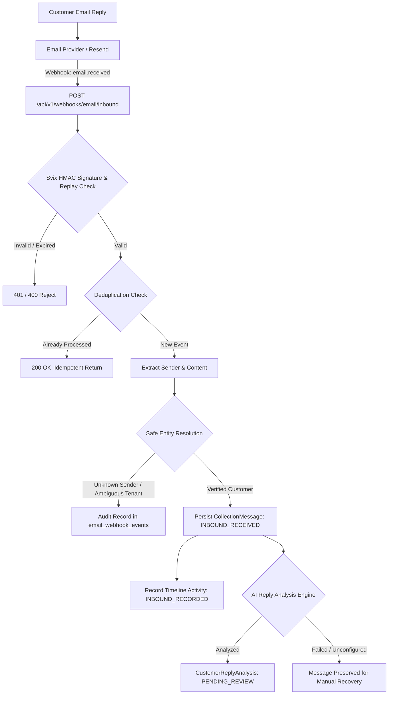

# Inbound Email Operations & Reply Ingestion Guide

## 1. Overview and Architecture

ACCO features an automated, auditable inbound email reply pipeline that ingests customer responses to outbound collections outreach. Customer replies are securely validated, deduplicated, linked to the customer and invoice, persisted into the collections workflow timeline, and analyzed by the advisory AI intelligence engine—without allowing automated customer statements to alter financial state without human authorization.



---

## 2. Webhook Endpoints

| Endpoint | Method | Purpose |
|---|---|---|
| `/api/v1/webhooks/email/inbound` | `POST` | Dedicated endpoint for inbound customer reply webhook events (`email.received`). |
| `/api/v1/webhooks/email/resend` | `POST` | Primary Resend webhook endpoint; transparently routes delivery status events (`email.delivered`, `email.bounced`, etc.) to delivery tracking and inbound replies (`email.received`) to the inbound reply pipeline. |

---

## 3. Provider Configuration Requirements

To receive live inbound emails using Resend:

1. **Domain & Receiving Route in Resend**:
   - Configure your sending and receiving domain in the Resend dashboard (e.g., `billing.yourdomain.com` or `yourdomain.com`).
   - Add the required MX records pointing to Resend inbound mail servers (`feedback-smtp.us-east-1.amazonses.com` or Resend MX records).
2. **Webhook Endpoint Configuration**:
   - In Resend Dashboard -> **Webhooks** -> **Add Webhook**:
     - **URL**: `https://<your-acco-domain>/api/v1/webhooks/email/inbound`
     - **Events to Subscribe**: Check `email.received` (and optionally delivery status events if using `/api/v1/webhooks/email/resend`).
3. **Webhook Signing Secret**:
   - Copy the Signing Secret generated by Resend (starts with `whsec_...`).
   - Set this value in your environment as `ACCO_EMAIL_WEBHOOK_SIGNING_SECRET`.

---

## 4. Environment Variables

All settings use the `ACCO_` prefix:

| Environment Variable | Description | Production Requirement |
|---|---|---|
| `ACCO_EMAIL_WEBHOOK_SIGNING_SECRET` | Secret key used to verify HMAC-SHA256 Svix webhook signatures (starts with `whsec_`). | **Mandatory** in production. Fails closed (503) if missing. |
| `ACCO_RESEND_API_KEY` | API key for Resend email operations and receiving API. | Mandatory for live email dispatch and API retrieval. |
| `ACCO_RESEND_FROM_EMAIL` | Default verified sender email (e.g., `billing@acco.app`). | Required for outbound collections outreach. |
| `ACCO_OPENAI_API_KEY` | OpenAI API key for advisory customer reply analysis. | Required for automatic AI reply analysis. |
| `ACCO_ENVIRONMENT` | Application environment (`development`, `test`, `production`). | Set to `production` in live deployments to enforce fail-closed verification. |

---

## 5. Security, Signatures, and Replay Protection

### 5.1 Svix Signature Verification
- Inbound webhooks provide standard Svix headers:
  - `svix-id`: Unique event message ID.
  - `svix-timestamp`: Unix timestamp in seconds.
  - `svix-signature`: Computed HMAC signature (e.g. `v1,<base64>`).
- ACCO removes the `whsec_` prefix, base64-decodes the secret bytes, and calculates `HMAC-SHA256` over `${svix-id}.${svix-timestamp}.${raw_body_bytes}`.
- Comparison is performed using constant-time `hmac.compare_digest` to prevent timing attacks.

### 5.2 Replay Protection Window
- Webhooks with a timestamp older than **300 seconds (5 minutes)** or in the future beyond this tolerance are rejected with HTTP 401.

### 5.3 Payload Safeguards
- Webhook payloads larger than **2 MB** are rejected with HTTP 413 (`Payload Too Large`).

### 5.4 Deduplication & Concurrency Protection
- Events are tracked in the database table `email_webhook_events`.
- A database-level unique constraint on `(provider, provider_event_id)` ensures duplicate deliveries and concurrent race conditions are handled idempotently.

---

## 6. Safe Reply Matching Algorithm

ACCO uses the strongest available evidence first and **never guesses**:

1. **Thread Reference Matching (`In-Reply-To` / `References`)**:
   - Headers are parsed for Message-IDs matching previously dispatched `email_deliveries.provider_message_id`.
   - When a match is found and the sender is verified, ACCO associates the reply with the original `CollectionMessage`, `Invoice`, and `Customer` with high confidence (`HIGH_THREAD_REFERENCE`).
2. **Sender Normalization (`email.utils.parseaddr`)**:
   - Senders such as `"John Doe <billing@customer.com>"` are sanitized to clean lowercase email addresses.
   - Senders with no matching customer in ACCO are rejected as `UNMATCHED_SENDER`; no financial record is created.
   - If the sender email matches multiple customers or organizations, ACCO flags it as `AMBIGUOUS_CUSTOMER` and refuses to guess across tenant boundaries.
3. **Invoice Matching Rules**:
   - **Explicit Mention**: If the email subject or body mentions a valid customer invoice number (e.g. `INV-2026-002`), it links directly (`HIGH_EXPLICIT_INVOICE_MENTION`).
   - **Single Open Invoice**: If the customer has exactly one open invoice, it associates with that invoice (`MEDIUM_SINGLE_OPEN_INVOICE`).
   - **Multiple Open Invoices**: If the customer has multiple outstanding invoices and no thread/explicit evidence, ACCO **does NOT guess the first invoice**. It stores the message with `invoice_id = None` and flags it as `AMBIGUOUS_MULTIPLE_OPEN_INVOICES` for human review.

---

## 7. Financial Safety & Human Review Boundary

- **Advisory Analysis Only**: AI reply analysis (`CustomerReplyAnalysis`) creates records with status `PENDING_REVIEW`.
- **No Automatic Financial Transitions**:
  - A customer stating "I have paid" **never** marks an invoice paid or updates ledger balances.
  - An extracted promise date or payment amount **never** creates an active `PaymentPromise` automatically.
  - Reviewers accept or dismiss analyses via `POST /api/v1/collections/reply-analyses/{analysis_id}/review`.
- **Activity Timeline**: Inbound replies and analysis creations emit `INBOUND_RECORDED` and `REPLY_ANALYSIS_CREATED` events to `collection_activities` for full auditability.

---

## 8. Failure Recovery & Operational Review

### 8.1 Analysis Failure Recovery
Inbound messages are committed to `collection_messages` before running AI analysis:
- If the AI provider is unavailable, rate-limited, or unconfigured, the inbound message remains safely recorded with `status = RECEIVED`.
- Reviewers can manually trigger or retry AI analysis at any time via:
  ```http
  POST /api/v1/collections/messages/{message_id}/analyze
  Authorization: Bearer <token>
  ```

### 8.2 Reviewing Unmatched and Ambiguous Messages
- Unmatched or rejected events are audited in `email_webhook_events` with detailed `error_detail` messages.
- Ambiguous customer messages (where `invoice_id = None`) are listed in:
  ```http
  GET /api/v1/collections/messages?direction=INBOUND
  Authorization: Bearer <token>
  ```
  Collectors can review the context and associate or create follow-up actions manually.

---

## 9. Testing the Integration Locally

You can test the entire pipeline locally without sending real emails or contacting external servers.

### 9.1 Running Automated Regression Tests
```bash
cd backend
pytest tests/test_inbound_email.py -v
```

### 9.2 Simulating an Inbound Reply via cURL
In development (`ACCO_ENVIRONMENT=development` and `ACCO_EMAIL_WEBHOOK_SIGNING_SECRET` unset or configured):

```bash
curl -X POST "http://localhost:8000/api/v1/webhooks/email/inbound" \
  -H "Content-Type: application/json" \
  -H "svix-id: evt_local_test_1" \
  -d '{
    "type": "email.received",
    "data": {
      "email_id": "msg_local_1",
      "from": "billing@customer.com",
      "to": ["billing@acco.app"],
      "subject": "Re: Invoice INV-001",
      "text": "We have sent the check today for $500."
    }
  }'
```

Expected response:
```json
{
  "status": "processed",
  "provider_event_id": "evt_local_test_1",
  "message_id": "...",
  "customer_id": "...",
  "invoice_id": "...",
  "match_confidence": "HIGH_EXPLICIT_INVOICE_MENTION",
  "analysis_status": "PENDING_REVIEW",
  "analysis_id": "..."
}
```
